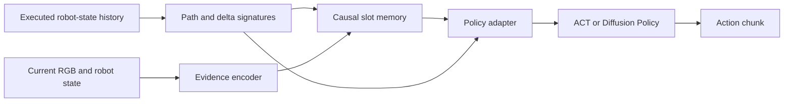

# Architecture

TRACE separates evidence storage from action generation. Current visual and
robot-state evidence is written to fixed-size latent slots; path and delta
signatures condition the write/read routing. An adapter exposes memory to the
policy's native conditioning interface.

The direct signature-to-adapter path is part of the complete method. The source
release fixes the method topology and exposes ordinary model-capacity and runtime
parameters. Component-removal implementations and alternative memory mechanisms
are absent.

## Source layout

Both policy packages use `src/` layouts and LeRobot's config/model/processor
separation. They remain separate distributions because Diffusion Policy reuses
the causal-prefix and signature-cache utilities from the ACT package.

| Public name | Serialized type | Package |
| --- | --- | --- |
| TRACE Regression | `streaming_act` | `lerobot_policy_streaming_act` |
| TRACE Diffusion | `prism_diffusion` | `lerobot_policy_prism_diffusion` |

`PRISM` and `SISM` can still appear in internal parameter names inherited from
development. They identify the same retained full-method computation, not an
additional public experiment. Parameter names are preserved where possible so
compatible full-method checkpoint tensors remain loadable.

## Causal prefix and online state

The training dataset builds a bounded causal prefix. Its first-frame sample and
recent tail preserve early evidence within a fixed training budget. That sample
is distinct from a separate first-frame-only conditioning module, which is not
included. Padding is masked, and episode boundaries must not share memory state.

At inference, the policy updates the same memory one executed step at a time.
Call `reset()` for each new episode. Signature dimensionality depends on state
dimension and truncation depth; slot capacity stays bounded over an episode.

## Compatibility

Keep the matching policy config and processors with a checkpoint. The release
accepts the retained main-method settings and rejects incompatible settings;
it does not silently convert an alternative model into TRACE. Exact bitwise
equivalence with a paper checkpoint needs that checkpoint and its complete
preprocessing artifacts, which are not part of this source bundle.
