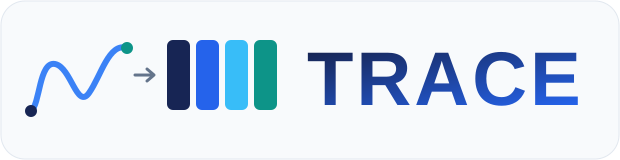
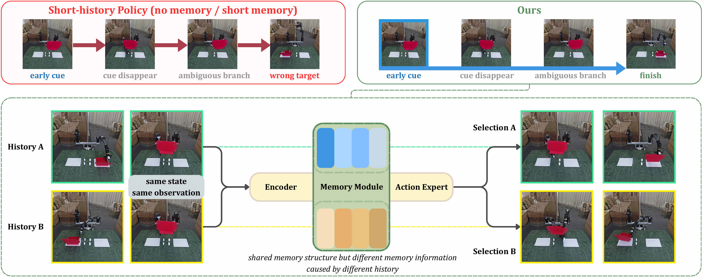

<div align="center">



## TRACE: Trajectory-Routed Causal Memory for Delayed-Evidence Visuomotor Imitation

**CoRL 2026 · 본회의 채택**

**Zihao Li<sup>1,2</sup> · Ranpeng Qiu<sup>2</sup> · Yincong Chen<sup>2</sup> · Guoqiang Ren<sup>2</sup> · Weiming Zhi<sup>1</sup>**

<sup>1</sup> **The University of Sydney** &emsp; <sup>2</sup> **Zeno AI**

[](https://github.com/Jeong-zju/corl-trace/actions/workflows/ci.yml)
[](https://jeong-zju.github.io/trace/assets/paper/trace-paper.pdf)
[](https://jeong-zju.github.io/trace/)
[](https://github.com/Jeong-zju/corl-trace)
[](../../LICENSE)

📄 [논문](https://jeong-zju.github.io/trace/assets/paper/trace-paper.pdf) |
💻 [코드](https://github.com/Jeong-zju/corl-trace) |
🌐 [프로젝트](https://jeong-zju.github.io/trace/) |
📚 [문서](../installation.md)

[English](../../README.md) · [简体中文](README.zh-CN.md) · [日本語](README.ja.md) · **한국어**

---



</div>

## ✨ 업데이트

- **[2026/10/08]** TRACE ACT／Diffusion 주 방법 코드와 영어·중국어·일본어·한국어 문서를 공개했습니다.

---

## 🔍 연구 동기

**단서를 기억하고, 필요한 순간에 행동합니다.** TRACE는 초기 단서가 나중의 의사결정 전에
사라지는 작업을 위해 시각-운동 정책에 고정 크기의 인과적 메모리를 제공합니다.
경로 시그니처는 이미 실행한 로봇 상태 궤적을 요약하고, 시각·상태 정보의 기록과 검색을
라우팅합니다. 가벼운 어댑터를 통해 이 메모리를 ACT 및 Diffusion Policy와 연결합니다.

## ⚙️ 주요 특징

| 구성 요소 | 역할 |
| --- | --- |
| **궤적 기반 라우팅** | 경로 및 델타 시그니처가 실행된 로봇 상태 궤적을 요약하고 메모리 읽기와 쓰기를 라우팅합니다. |
| **인과적 슬롯 메모리** | 고정된 수의 잠재 슬롯이 시각·상태 정보를 보존하여 초기 단서가 사라진 뒤의 판단을 지원합니다. |
| **두 가지 정책 인터페이스** | 가벼운 어댑터가 ACT와 Diffusion Policy의 기존 조건 입력에 메모리를 연결합니다. |
| **실행 가능한 소스 코드** | 데이터 도구, 참고 설정, CPU 예제 및 핵심 기능 테스트를 제공합니다. |

---

## 📚 목차

- [공개 내용](#release-contents)
- [설치 및 빠른 시작](#installation)
- [학습](#training)
- [평가](#evaluation)
- [코드 구성](#code-structure)
- [개발](#development)
- [인용](#citation)
- [라이선스 및 감사의 말](#license)

---

<a id="release-contents"></a>

## 📦 공개 내용

- 회귀형(ACT) 및 확산형 인터페이스를 갖춘 **완전한 TRACE 주 방법**.
- 인과적 프리픽스 데이터셋, 시그니처 캐싱, 학습, 오프라인 및 시뮬레이션 평가.
- 합성 관측과 실제 경로 시그니처를 사용하며 사전 학습된 가중치를 다운로드하지 않는 CPU 예제.
- 참고 설정, 핵심 기능 테스트, 4개 언어 문서.

이 릴리스에는 주 방법만 포함됩니다. 구성 요소 제거 실험(ablation)의 구현, 비교 실험,
비공개 로봇 배포 설정은 제외됩니다. 데이터셋, 학습된 가중치, 논문의 개별 실행에 해당하는
전체 산출물은 **포함되어 있지 않습니다**. 참고 설정은 시작을 돕기 위한 것이며 논문 결과의
정확한 재현을 보장하지 않습니다. [공개 범위](../../docs/release-scope.md)를 확인하세요.

---

<a id="installation"></a>

## 🚀 설치 및 빠른 시작

참고 환경은 Linux와 Python 3.12입니다. 저장소를 복제한 뒤 루트 디렉터리에서
다음 명령을 실행하세요. Signatory를 빌드하기 전에 시스템 FFmpeg와 C++ 컴파일러를
설치하세요. GPU 학습에는 드라이버와 호환되는 PyTorch / CUDA 환경이 필요합니다.

```bash
git clone https://github.com/Jeong-zju/corl-trace.git
cd corl-trace

python3.12 -m venv .venv
source .venv/bin/activate
python -m pip install --upgrade pip
python -m pip install -r requirements.txt
python -m pip install -e depends/signatory --no-build-isolation
python examples/smoke_trace.py
```

이 예제는 무작위로 초기화한 작은 CPU 모델을 사용합니다. 메모리를 거치는 전체 계산 경로가
유한한 행동 값을 출력하는지 확인하며, 작업 성공률을 측정하지는 않습니다.
환경 구성 및 빌드에 관한 자세한 내용은 [설치 안내](../../docs/installation.md)를 참고하세요.

---

<a id="training"></a>

## 🏋️ 학습

동기화된 RGB 관측, 로봇 상태, 행동이 포함된 로컬 LeRobot v3 데이터셋을 준비하세요.
`data/local/task`를 데이터셋 디렉터리로 바꿉니다. 전처리는 별도의 출력 데이터셋을
생성하므로 입력 데이터셋도 계속 사용할 수 있습니다.

```bash
python data/process_dataset.py data/local/task \
  --output-dir data/local/task_trace --signature-depth 3

python scripts/train_policy.py --policy streaming_act \
  --defaults-path configs/trace_act.yaml --dataset data/local/task_trace

python scripts/train_policy.py --policy prism_diffusion \
  --defaults-path configs/trace_diffusion.yaml --dataset data/local/task_trace
```

두 설정 모두 TRACE의 전체 계산 경로와 고정된 난수 시드를 사용합니다.
실험 추적은 기본적으로 꺼져 있습니다. 데이터 분할, 정규화, 체크포인트에 관한 자세한 내용은
[데이터 준비](../../docs/data.md)와 [학습](../../docs/training.md)을 참고하세요.

---

<a id="evaluation"></a>

## 🧪 평가

```bash
python scripts/eval_policy.py --policy streaming_act \
  --policy-path outputs/train/trace-act/RUN/checkpoints/STEP/pretrained_model \
  --dataset data/local/task_trace
```

체크포인트 경로를 실제 저장 디렉터리로 바꾸세요. 오프라인 행동 예측 오차는 로봇의 작업
성공률과 다릅니다. 시뮬레이션에는 해당 환경과 자산이 필요합니다.
[평가 안내](../../docs/evaluation.md)를 참고하세요.

---

<a id="code-structure"></a>

## 🗂️ 코드 구성

| 경로 | 용도 |
| --- | --- |
| `policy/lerobot_policy_streaming_act/src/` | TRACE 메모리 및 ACT 인터페이스 |
| `policy/lerobot_policy_prism_diffusion/src/` | TRACE 메모리 및 Diffusion Policy 인터페이스 |
| `configs/` | 공개 주 방법의 학습 설정 |
| `scripts/` | 학습, 평가, 데이터셋 유틸리티 |
| `data/` | LeRobot 변환 및 경로 시그니처 전처리 |
| `examples/` | 실행 가능한 CPU 예제 |
| `tests/` | 주 방법, 데이터, 릴리스 검증 |
| `docs/` | 설치, 방법, 학습, 평가, 번역 |
| `depends/signatory/` | 함께 제공되는 시그니처 구현 및 원본 라이선스 |

`streaming_act`와 `prism_diffusion`은 두 TRACE 인터페이스에서 기존부터 직렬화에 사용한
정책 이름입니다. 주 방법 체크포인트의 파라미터 이름을 유지하기 위해 그대로 사용합니다.
이름 간의 대응 관계와 호환성 요구 사항은 [아키텍처](../../docs/architecture.md)를 참고하세요.

---

<a id="development"></a>

## 🛠️ 개발

```bash
python -m pip install -r requirements-dev.txt
python -m ruff check .
python scripts/check_release.py
python -m pytest
```

모델 관련 의존성 없이 작은 CPU 유틸리티 테스트를 실행하려면 `requirements-test.txt`를
설치하고 `python -m pytest --lightweight`를 실행하세요.
개발 절차는 [CONTRIBUTING.md](../../CONTRIBUTING.md)를 참고하세요.

---

<a id="citation"></a>

## 📄 인용

```bibtex
@inproceedings{li2026trace,
  title     = {TRACE: Trajectory-Routed Causal Memory for Delayed-Evidence Visuomotor Imitation},
  author    = {Li, Zihao and Qiu, Ranpeng and Chen, Yincong and Ren, Guoqiang and Zhi, Weiming},
  booktitle = {Conference on Robot Learning},
  year      = {2026},
  url       = {https://jeong-zju.github.io/trace/}
}
```

---

<a id="license"></a>

## 📜 라이선스 및 감사의 말

TRACE 자체 기여분은 [Apache-2.0](../../LICENSE) 라이선스로 공개됩니다.
이 프로젝트는 LeRobot, ACT, Diffusion Policy, Signatory를 기반으로 합니다.
각 프로젝트의 고지와 라이선스는 [THIRD_PARTY_NOTICES.md](../../THIRD_PARTY_NOTICES.md)에
보존되어 있습니다. 외부 데이터와 가중치에는 각각의 라이선스가 적용됩니다.

---

<div align="center">

**TRACE** · 단서를 기억하고, 필요한 순간에 행동합니다.

</div>
